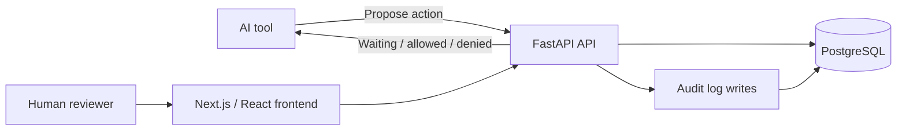

# AI Action Approval Engine

A human-control layer for actions proposed by AI tools, built on the existing production-style workflow approval platform. An AI tool submits the exact action it wants to take, the server assigns a non-editable risk level, and a human approves or rejects it through the existing workflow. The tool can then read a clear `WAITING_FOR_HUMAN`, `ALLOWED`, or `DENIED` decision.

This project does not claim to invent approval software or to make an LLM approve its own work. Its purpose is to keep important AI actions under accountable human control while preserving the deterministic workflow, transactional audit trail, and observability of the original system. Ordinary manual approval requests remain supported.

## Resume Highlights

- Built a production-style end-to-end workflow approval platform using FastAPI, PostgreSQL, Next.js, React, TypeScript, Docker Compose, Prometheus, and Grafana.
- Added a model-agnostic AI action API that captures the requested action, target, exact payload, model identity, rationale, and a server-owned risk rating before human review.
- Exposed a machine-readable decision endpoint so integrated AI tools can remain blocked until a human returns an allowed decision.
- Implemented a finite-state machine (FSM) to enforce legal workflow transitions with HTTP 409 responses for invalid state changes.
- Guaranteed transactional consistency by writing workflow state updates and audit logs atomically within a single database transaction.
- Instrumented the application with Prometheus business metrics and Grafana dashboards for workflow creation, state transitions, latency, throughput, and process metrics.
- Benchmarked concurrent workflow lifecycles using a custom asynchronous benchmarking tool and documented throughput, latency, p50, p95, p99, and error-rate characteristics.
- Configured GitHub Actions CI for backend testing and frontend lint/build validation.

## Resume Metrics

- Test suite: 19 passing pytest tests covering the original workflows plus blocked, allowed, denied, server-owned risk, and missing-action cases for AI proposals.
- Benchmark scale: 500 workflow lifecycles completed with 500/500 successes and 0.0% error rate at 20-way concurrency.
- Best measured refresh result: 3.8 workflows/sec, p50 latency 4,935.19 ms, p95 latency 6,375.92 ms, and p99 latency 7,560.14 ms.

## Quick Start

Run the full stack:

```bash
docker compose up -d --build
```

Default service URLs:

| Service | URL |
| --- | --- |
| Frontend | http://localhost:3000 |
| API | http://localhost:8000 |
| API docs | http://localhost:8000/docs |
| PostgreSQL | localhost:5432 |

If local ports are already in use:

```bash
API_PORT=18080 FRONTEND_PORT=13000 POSTGRES_PORT=15432 \
NEXT_PUBLIC_API_URL=http://localhost:18080 \
docker compose up -d --build
```

Alternate URLs used during verification:

| Service | URL |
| --- | --- |
| Frontend | http://localhost:13000 |
| API | http://localhost:18080 |
| PostgreSQL | localhost:15432 |

## Architecture



## Tech Stack

| Layer | Technologies |
| --- | --- |
| Backend | Python, FastAPI, SQLAlchemy, Pydantic, Uvicorn |
| Frontend | Next.js, React, TypeScript, Tailwind CSS |
| Database | PostgreSQL |
| Infrastructure | Docker, Docker Compose |
| CI | GitHub Actions |
| Testing | pytest, FastAPI TestClient |
| Observability | Prometheus, Grafana |

## Workflow Model

Allowed state transitions:

```text
PENDING -> APPROVED
PENDING -> REJECTED
```

Every workflow create and transition writes an audit log entry. Invalid transitions return an error instead of changing state.

## API Endpoints

| Method | Endpoint | Description |
| --- | --- | --- |
| `GET` | `/health` | Health check |
| `POST` | `/workflows` | Create workflow |
| `GET` | `/workflows` | List workflows, optionally filtered by `state` |
| `GET` | `/workflows/{id}` | Workflow detail with audit history |
| `POST` | `/workflows/{id}/approve` | Approve pending workflow |
| `POST` | `/workflows/{id}/reject` | Reject pending workflow |
| `POST` | `/ai-actions` | Submit an AI-proposed action for human approval |
| `GET` | `/ai-actions/{id}` | Read the original AI proposal and risk evidence |
| `GET` | `/ai-actions/{id}/decision` | Read whether the action is waiting, allowed, or denied |

## Testing

Run backend tests:

```bash
python -m pytest tests -v
```

Previously verified result:

```text
19 passed
```

Run frontend checks:

```bash
cd frontend
npm run lint
npm run build
```

GitHub Actions runs backend tests plus frontend lint/build on push and pull request.

## Benchmarks

Benchmark tooling:

```bash
python scripts/benchmark_api.py --base-url http://localhost:8000 --count 500 --concurrency 20
```

Measured results are stored in [docs/metrics.md](docs/metrics.md).

| Workflows | Concurrency | Successful | Failed | Error rate | Throughput | Mean latency | p50 latency | p95 latency | p99 latency |
| ---: | ---: | ---: | ---: | ---: | ---: | ---: | ---: | ---: | ---: |
| 100 | 20 | 100 | 0 | 0.0% | 3.35 workflows/sec | 5,112.57 ms | 4,922.87 ms | 7,127.41 ms | 7,211.89 ms |
| 250 | 20 | 250 | 0 | 0.0% | 3.17 workflows/sec | 5,746.81 ms | 4,978.23 ms | 14,661.24 ms | 15,057.13 ms |
| 500 | 20 | 500 | 0 | 0.0% | 3.8 workflows/sec | 5,055.51 ms | 4,935.19 ms | 6,375.92 ms | 7,560.14 ms |

## Observability

Business metrics exposed through /metrics:

- workflow_created_total
- workflow_transition_total
- workflow_invalid_transition_total

Infrastructure metrics:

- HTTP request throughput
- HTTP request latency
- Memory usage
- Open file descriptors

| Service | URL |
| --- | --- |
| Prometheus | http://localhost:9090 |
| Grafana | http://localhost:3001 |

## Deployment

The project is deployable as Docker containers:

- `app`: FastAPI API service
- `frontend`: Next.js frontend service
- `db`: PostgreSQL service

Configuration is environment-driven. See [.env.example](.env.example) for database URL, CORS origins, public frontend API URL, internal Docker API URL, and port overrides.

No Kubernetes manifests are included in this repository.

## Demo / Screenshots

The running demo exposes:

- Dashboard and workflow list at the frontend URL.
- Workflow creation form.
- Workflow detail page with approve/reject actions.
- Audit history for create and transition events.
- Swagger API documentation at `/docs`.

Screenshots to include:

- Frontend dashboard
- Workflow detail page
- Swagger API documentation
- Prometheus metrics
- Grafana observability dashboard

## Local Development

Backend:

```bash
python -m venv venv
source venv/bin/activate
pip install -r requirements.txt
uvicorn app.main:app --reload --port 8000
```

Frontend:

```bash
cd frontend
cp .env.local.example .env.local
npm install
npm run dev
```

## Known Limitations

- Authentication and authorization are intentionally not implemented; the portfolio UI sends `owner_id` and `actor_id` as plain strings.
- The decision endpoint is a control-plane MVP. A connected AI tool must honor the decision; signed execution permits and downstream enforcement are the next security boundary.
- Database schema is created on startup with SQLAlchemy metadata; production migrations such as Alembic are not included.
- Benchmarks were collected on a local Docker Desktop environment, so absolute latency will vary by machine.
- Benchmark runs create durable PostgreSQL records unless the database volume is reset.

## Failure Mode Validation

Failure mode tested: requests for nonexistent workflow IDs return HTTP 404 instead of silently succeeding or corrupting workflow state. The test suite covers this failure path alongside successful workflow creation, approval, filtering, and audit-log validation.
